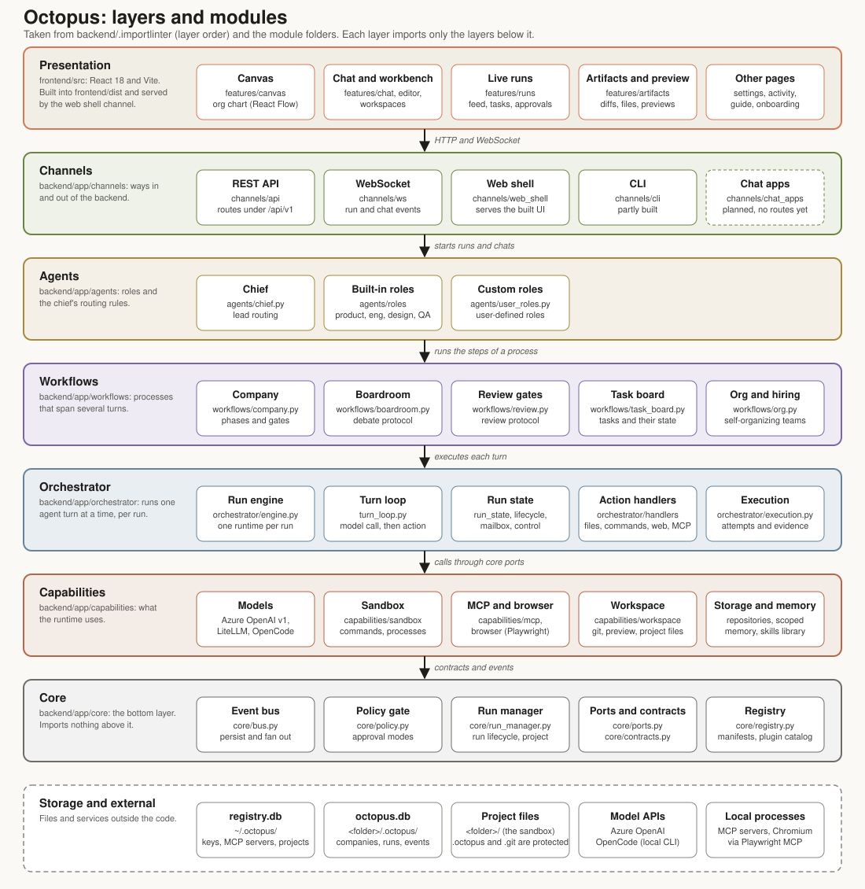

# Octopus architecture

Octopus runs a team of AI agents against a project folder. The backend is a small **kernel** that runs agents, plus
**plugins** that fill typed slots (model providers, tools, workflows, roles, sandbox, workspace, knowledge, observers and
channels). The guide for writing a plugin is `docs/plugins.md`. The diagram is `docs/architecture-layers.svg`.

## 1. Layers

Packages live in `backend/app/`. A layer may import the layers below it, and nothing else. import-linter enforces this
(`make lint-arch`, two contracts, no ignore list).

| Layer | Package | What it holds |
|---|---|---|
| Composition | `main.py`, `bootstrap.py` | `bootstrap.py` is the only file that lists the built-in plugins and builds the kernel. `main.py` builds the FastAPI app around it and mounts the channel plugins. |
| Channels | `channels/` | The ways in: REST routes (`api/routes/`), WebSocket (`ws/`), web shell, CLI, chat apps (planned). Each is a plugin of the `channel` slot. |
| Application | `application/` | Use cases the channels call: projects and folders, the editor and file items, chat, the native folder dialog, host paths, benchmarks. |
| Kernel | `kernel/` | Plugin host, service/tool/run-method registries, policy gate, event log, run manager and the run runtime (`kernel/runtime/`). Knows no provider, tool or workflow by name. |
| Plugins | `plugins/` | Eleven packages that hold 30 plugins (section 3). |
| Storage | `storage/` | SQLAlchemy models, sessions, Alembic runner and the repositories. |
| SDK and foundation | `sdk/`, `foundation/` | `sdk` is the contract plugins build against. `foundation` is config, logging and secrets. |

Two rules matter more than the order:

- **The kernel and the plugins do not import each other.** They meet through the service registry, the tool registry and the
  run-method table. A plugin imports only `sdk`, `storage` and `foundation`.
- **Plugin packages do not import each other.** A plugin that needs another asks the host for a capability by name
  (`deps.require("sandbox.exec")`) and declares it in its manifest.

`channels` and `application` may import plugin modules directly. The routes use libraries such as git, the sandbox
processes and the org templates that way, so switching those plugins off does not remove the routes that call them
(section 9).

## 2. The SDK

`backend/app/sdk/` is what a plugin builds against. It imports nothing else from the app.

- `manifest.py`: **Manifest v2**. `id`, `slot`, `kind`, `version`, `provides`, `requires`, `optional`, `permissions`, `emits`
  (run topics), `ui` (Settings sections), `start` (`eager` or `lazy`), `required`, `sdk` (a version range) and `status`.
  Validation rejects unknown slots, permissions and topics, a bad SDK range, and a capability that is both required and optional.
- `plugin.py`: the plugin contract (`register`, `start`, `stop`, `health`), `PluginBase`, `ServicePlugin` (a plugin described by
  data), `HostApi` and `Deps` (a package's late-bound view of other plugins' services).
- `run.py`: `RunContext`, the live run as plugins see it.
- Contract types: actions and tool specs (`actions.py`, `toolspecs.py`), LLM request/response types (`llm.py`), agents and
  channel routing (`agents.py`, `routing.py`), protocol state (`protocols.py`), task and execution contracts, evidence,
  skill and workflow contracts, request/response schemas, topics (`topics.py`) and the project file boundary (`projectfs.py`,
  `paths.py`).

`projectfs.py` is in the SDK on purpose. It is the single place that rejects absolute paths, `..`, symlinks that escape the
project, protected folders and secret-looking names. A plugin cannot replace it.

## 3. Plugins

`backend/app/bootstrap.py` lists them. `Settings → Plugins` shows them.

| Slot | Plugins | Package |
|---|---|---|
| kernel (required) | `kernel.eventlog`, `kernel.policy`, `kernel.runs`, `kernel.host` | `kernel/core.py` |
| channel | `channel.api` (required), `channel.ws` (required), `channel.web_shell`, `channel.cli`, `channel.chat_apps` (planned) | `channels/` |
| provider | `provider.router` (required), `provider.azure`, `provider.litellm`, `provider.opencode` | `plugins/providers/` |
| tool | `tool.files`, `tool.commands`, `tool.web`, `tool.mcp`, `tool.memory`, `tool.skills`, `tool.messaging` (required), `tool.delegation`, `tool.team`, `tool.workflow` | `plugins/tools/`, `plugins/workflows/` |
| workflow | `workflow.task_board` (required), `workflow.boardroom`, `workflow.review`, `workflow.org`, `workflow.company` | `plugins/workflows/` |
| role | `role.builtin` (required), `role.library`, `role.chief` (required) | `plugins/roles/` |
| knowledge | `knowledge.skills`, `knowledge.memory` | `plugins/skills/`, `plugins/memory/` |
| runner | `runner.sandbox` (required) | `plugins/sandbox/` |
| workspace | `workspace.local` (required) | `plugins/workspace/` |
| service | `service.mcp`, `service.browser` | `plugins/mcp/`, `plugins/browser/` |
| observer | `observer.fx`, `observer.report` | `plugins/observers/` |

"Required" means the run loop cannot work without it, so it has no switch. Everything else can be switched off.

A plugin offers three kinds of things through the host:

- **Services**, by capability name (`provide("sandbox.exec", module)`), looked up with `services.get` or `require`.
- **Tool actions**, by family (`add_tools("files", {...})`). The run engine dispatches an agent's action through the tool registry.
  The model is not offered an action whose plugin is off, and an action it still sends gets a notice instead of a crash.
- **Run methods** (`add_run_methods`), which a plugin adds to every live run. The task board and the tools call each other this
  way (`rt.open_tasks()`, `rt.publish_file(...)`) instead of importing.

## 4. The plugin host

`kernel/host.py`. Lifecycle of one plugin: validate (manifest, SDK range, dependency graph) → resolve (providers before the
plugins that need them) → `register` → `start` → healthy or degraded → `stop` (reverse order).

- `load()` is synchronous and does no I/O, so a process (or a test that never runs the ASGI lifespan) has every service in place.
  `start()` and `stop()` run in the lifespan.
- The `plugins` table in the registry database stores the enabled state. `apply_persisted()` reads it at start-up.
- `set_enabled(plugin, enabled, cascade)` checks dependents first. Switching off `workflow.org` without `cascade` is refused
  because `tool.team` needs it. Whatever a plugin added (services, tools, run methods, event subscriptions) is removed with it.
- A plugin that fails to register or start is marked `failed` and the others keep working. A required plugin that fails stops the boot.
  A plugin whose requirement was switched off starts as `blocked`.
- With the company workflow or the org plugin off, a run uses neutral stand-ins (`kernel/runtime/nullflow.py`) and is free-form.
- `GET /api/v1/plugins` and `PATCH /api/v1/plugins/{id}` expose this. Channels apply at the next start, because their routes are mounted once.

## 5. Run flow

`kernel/runtime/engine.py` holds `RunRuntime`, one asyncio task per run, built by `Kernel` with the kernel as an argument
(`current()` is the fallback for tests and scripts). Each turn:

1. `turn_loop.py` builds the prompt (system prompt, roster, channels, blackboard, summary, inbox).
2. The model is called through the `models.router` service, or an agent backend such as `models.turn_opencode` runs the whole turn.
3. The reply (native tool calls, or a JSON envelope) is parsed into actions (`sdk/actions.py`).
4. Each action is dispatched through the tool registry. Every action that changes something calls `rt.guard(...)`, which is
   `PolicyGate.decide`.
5. Messages are routed to mailboxes, events go to the event log, and the loop repeats until the run finishes or waits for the user.

Run bookkeeping lives in `run_state.py`, `run_control.py`, `mailbox.py`, `board.py`, `lifecycle.py` and `execution.py` (attempts,
evidence, checkpoints, the request queue).

## 6. Approvals

One approval setting per user: `ask` (every gated action asks) or `auto` ("Approve for me": only dangerous actions ask).
`kernel/policy.py` (`PolicyGate.decide`) makes every decision. The approval events and payloads are the same in both modes and
are frozen by the golden files.

## 7. Events

`kernel/eventlog.py`. Every event except the live-only topics (`token_stream`, `thinking_stream`) is written to `run_events` with
a monotonic `seq`.

- **Group commit.** Events published while a write is in flight join the next transaction. `publish` still returns only after its
  event is committed and delivered, so ordering and durability are what one commit per event gave. In a micro-benchmark with
  concurrent publishers on SQLite (200 events per run, 1 to 8 runs) it moved about 2,900 events/s against about 1,300/s with one
  commit per event. A single publisher awaiting each event sees the same latency as before.
- **No silent drops.** A subscriber whose queue is full is flagged `lagged`; the WebSocket handler then re-reads the log from the
  last `seq` it sent. Live-only events dropped for a slow reader are counted. `stats()` is part of `GET /api/v1/plugins`.
- A failed write raises in the publisher, and the writer keeps running.
- Plugins can observe delivered events (`HostApi.subscribe`).

## 8. Storage

| Store | Location | Contents |
|---|---|---|
| Registry | `$OCTOPUS_HOME/registry.db` (default `~/.octopus`) | users, encrypted provider keys, MCP servers, workspaces, the `plugins` table |
| Project | `<project>/.octopus/octopus.db` | companies, agents, edges, sessions, runs, messages, run events, tasks, artifacts, memory |
| Project files | `<project>/…` | what agents read and write (sandboxed by `sdk/projectfs.py`) |
| Working docs | `<project>/.octopus/work/` | the only part of `.octopus/` agents can use |

Queries go through `storage/repositories.py`. Repositories do not commit. Both databases are migrated with Alembic
(`backend/migrations/{registry,project}`). SQLite runs in WAL mode.

## 9. Known limits

- `channels` and `application` import some plugin libraries directly (git, worktrees, sandbox processes, org templates, the
  canvas, browser live view, model credentials). Switching those plugins off does not remove those routes.
- Plugins are Python packages in this repository. `build_kernel(extra=[...])` accepts more, but there is no discovery from the
  environment and no out-of-process plugin runtime.
- Manifests have no per-plugin configuration schema. Settings still live in the environment and in the existing settings pages.
- A plugin package keeps a late-bound `Deps` object at module level. Several kernels in one process share it; the first one built
  with `make_current` wins. The model router also keeps its provider list per process.
- `RunContext` documents a stable subset. The built-in plugins use more of the run's members than it lists.
- The host wraps `start`, `stop` and `health` in timeouts. Calls into a plugin's service are not wrapped in a timeout, retry or
  circuit breaker (model calls keep the retry that was already there).
- Runs rebuild from the persisted run state and the request queue, not from the event log alone.

## 10. Verification

- **Golden files** (`backend/tests/golden/`, regenerate with `python -m scripts.golden.export_all`): OpenAPI, schemas, tool names
  and schemas, prompts, approval and sandbox cases, scripted run event sequences, protocol transcripts.
- **Architecture rules** (`backend/.importlinter`): the layer contract and plugin independence.
- **Host tests** (`tests/test_plugin_host.py`): the built-in set, start order, switching with dependents, saved state, failures,
  manifests that declare every capability the code looks up, and runs that keep going with a plugin off.
- **Tests**: `pytest` for the backend, `vitest` and `tsc --noEmit` for the frontend, screenshots in `scripts/visual/`.
