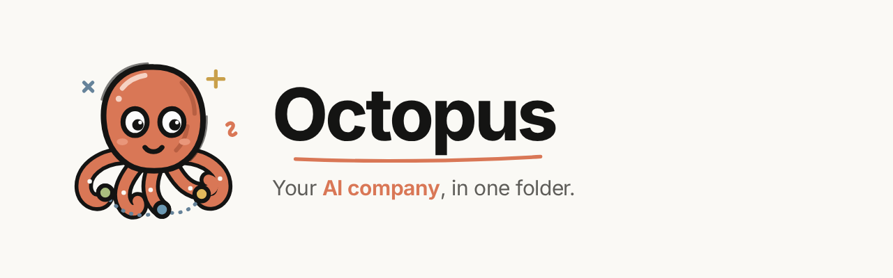
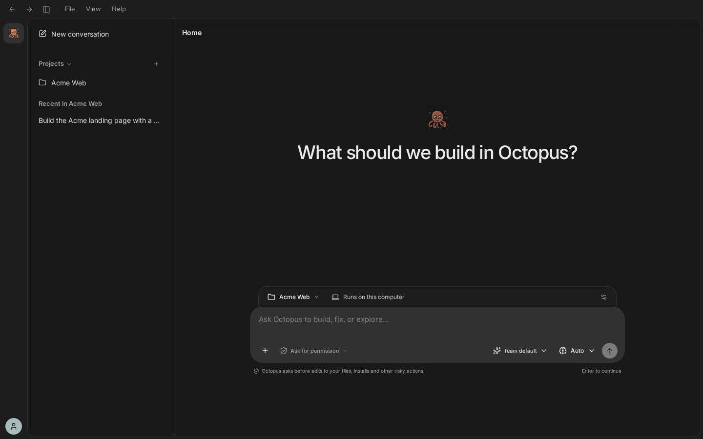
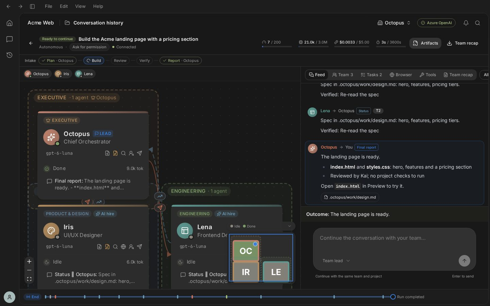
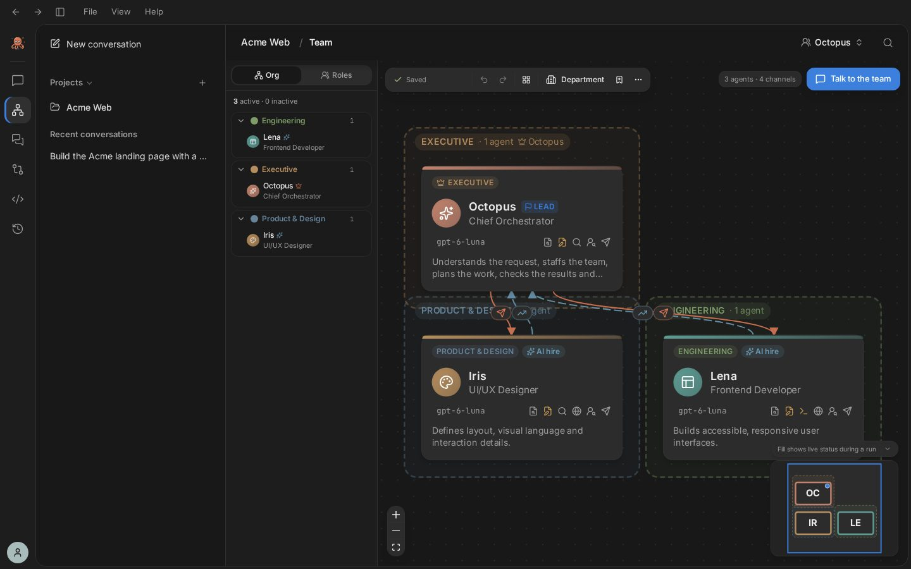
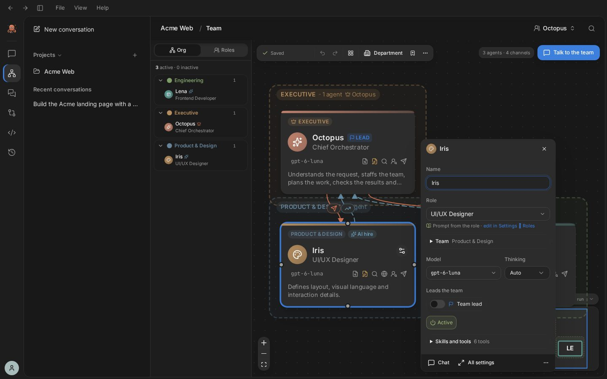
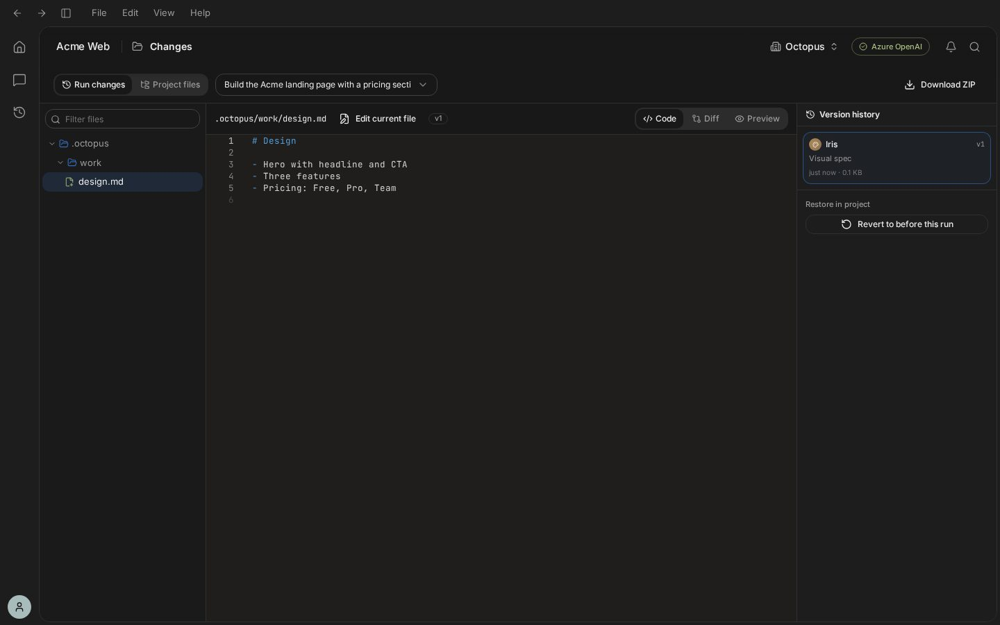
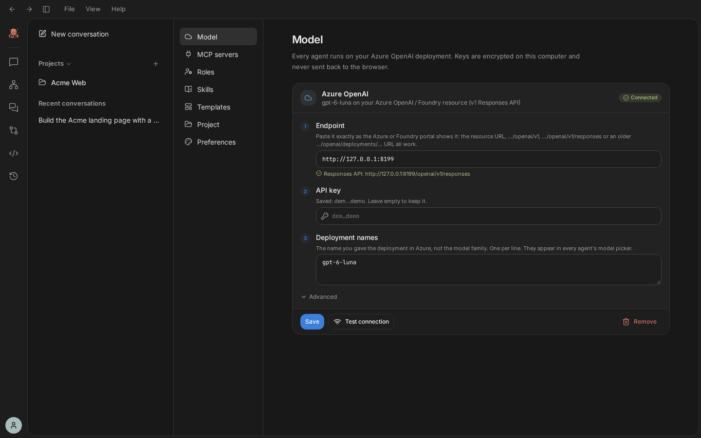

<p align="center">
  <picture>
    <source media="(prefers-color-scheme: dark)" srcset="docs/brand/banner-dark.png">
    
  </picture>
</p>

<p align="center">
  <a href="https://github.com/bala2006/octopus/actions/workflows/ci.yml"></a>
  <a href="LICENSE"></a>
  
  
</p>

**Octopus** is a one-person company. You open a project folder and say what you want, the way you would in a coding
chat. Octopus, the team lead, works out who the job needs, hires those specialists onto a live org chart, briefs
them, and runs the work: designers, engineers, reviewers and QA, in parallel where they can be. Every change is reviewed
by someone other than its author and checked with your project's own tests before Octopus reports back. Then you reply
with feedback or the next request, and the same team carries on.

## How it works

1. **You ask.** In the conversation, as in any coding assistant. Attach files, screenshots or code selections.
2. **Octopus staffs the work.** It reads the request and your code, answers directly when no work is needed, asks
   when a decision is genuinely yours, and otherwise hires from the role library (frontend, backend, design, QA,
   security, data, writing, …) and creates tasks with owners, acceptance criteria and an order. New hires appear on
   the team's org chart as they join.
3. **The team builds.** Each specialist works on their task with real tools: reading and editing files, running builds
   and tests, using a browser, searching the web, your MCP servers. They consult each other and keep notes that
   carry over to the next request.
4. **Quality is built in.** For a feature, your asks become a list of requirements in your words; anything left out is
   shown with the reason. Each part has one owner who builds it, and specialists sharpen it every round: a code
   reviewer always, an art director for anything you look at, a QA engineer for anything you use. Your project's
   tests, type checks and lint run after changes, then a QA engineer runs the product and checks each requirement;
   failures go back to whoever built that part. The shared engineering standards ask for complete code, existing
   conventions, real copy and honest reporting.
5. **You get a report** with what changed, where and how it was verified, followed by each requirement's status and
   everything still open. Your next message continues the conversation.

Each job has one place in the app: **Conversation** (talk to the team lead and watch the team work), **Team** (design
the org chart yourself or start from a template such as Software Startup or Web App Studio), **Direct chats** (one-on-one
with a single agent), **Changes** (every file a conversation changed, with diffs and revert), **Code** (editor, Git,
terminal, preview) and **History** (every conversation with its cost and outcome).

## Safe in your project

Agents work in your real folder, so the server enforces the limits, not the model:

- **Nothing is lost.** Every file the team changes is versioned with its author and reason; *Changes* shows diffs and
  reverts any file. Deletes go to a recoverable trash.
- **Destructive commands never run.** Commands run without a shell, with a timeout and without your keys. `rm`,
  `git reset --hard`, `git clean`, force pushes, `sudo`, shells and paths outside the project are refused.
- **You approve what matters.** *Ask for permission* asks before the team edits files you already had, deletes, installs,
  changes Git history or uses an MCP server. *Approve for me* asks only for high-risk actions like pushing or
  publishing. Creating new files never asks.
- **Local only.** The server listens on `127.0.0.1`, rejects requests from other sites, and keeps your Azure key
  encrypted on your computer.

One limit to know: when the team runs your project's code (`npm test`, `node script.js`), that program runs with your
user's permissions. The policy checks which command runs, not what the program does, so use Git (or a worktree from
the project picker) for work you cannot afford to lose.

## Quick start

Requirements: **Node.js 22.22+** (24 recommended) and an **Azure OpenAI** deployment (`gpt-6-luna` by default).

```bash
npm install
npm start          # builds the app when needed and serves http://127.0.0.1:8000
# or, with hot reload:
npm run dev
```

1. Open **Settings → Model**, paste your Azure endpoint as the portal shows it, add the key (or use Microsoft Entra ID
   with `az login`), and press **Test connection**.
2. **Open project folder**, then type what you want: *"Build a landing page with a pricing section"*.
3. Watch the team work next to the chat, approve what it asks, and reply when it reports.

Settings can also come from a `.env` file; see [`.env.example`](.env.example). Use `OCTOPUS_PORT` to change the port.

## Costs

Octopus reads the exact usage Azure reports for each call and prices it at gpt-6-luna Standard rates (USD per 1M
tokens: $0.10 input, $0.01 cached input, $0.50 output, with long-prompt and regional surcharges). You can override the
rates and show costs in your currency. Each task has a step limit, and a task that keeps testing is told to wrap up before it.

## Development

```bash
npm run typecheck   # all three workspaces
npm test            # server engine tests (scripted model, no credentials) and web tests
npm run build
```

The code is TypeScript end to end: `shared/` holds the contract, `server/` the engine and API, `web/` the app. See
[ARCHITECTURE.md](ARCHITECTURE.md) for how a conversation runs and how safety is enforced.

## Screenshots

| | |
|---|---|
|  |  |
|  |  |
|  |  |

## Community

Octopus is released under the [MIT License](LICENSE). Read [CONTRIBUTING.md](CONTRIBUTING.md) before opening a pull
request, [SECURITY.md](SECURITY.md) for vulnerability reports, and [SUPPORT.md](SUPPORT.md) for help.
