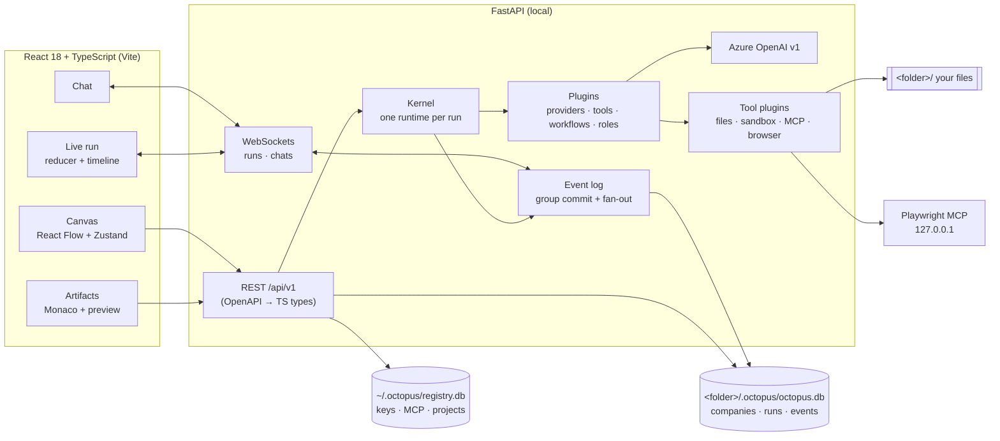
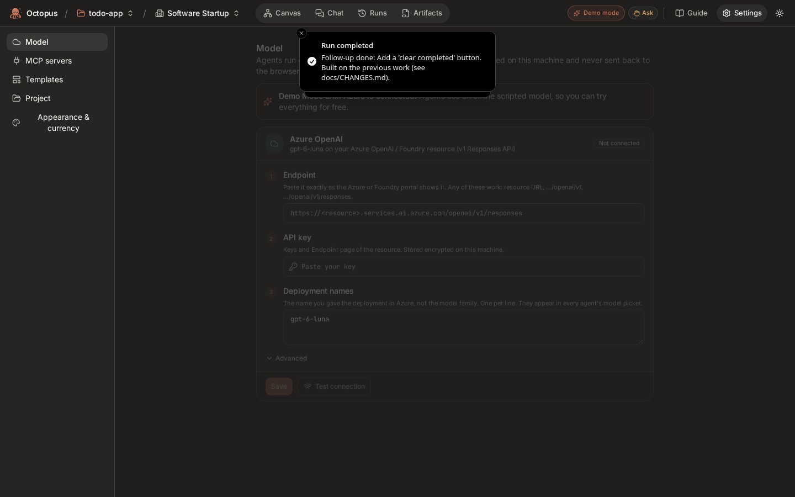
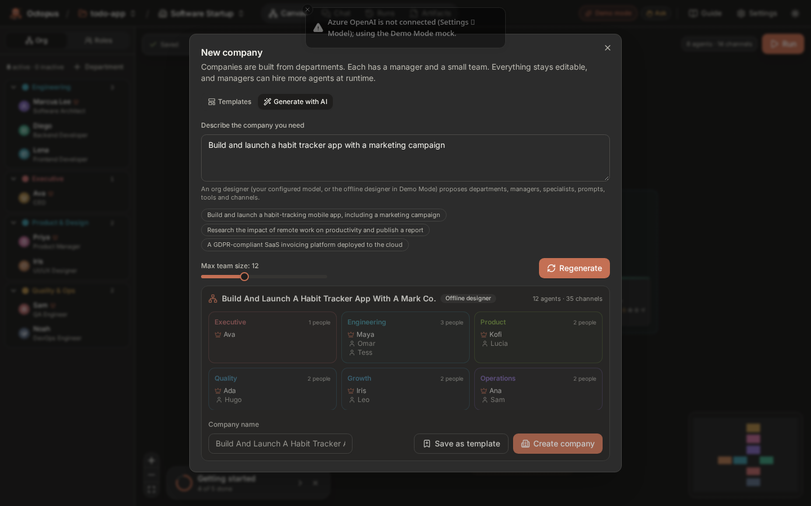
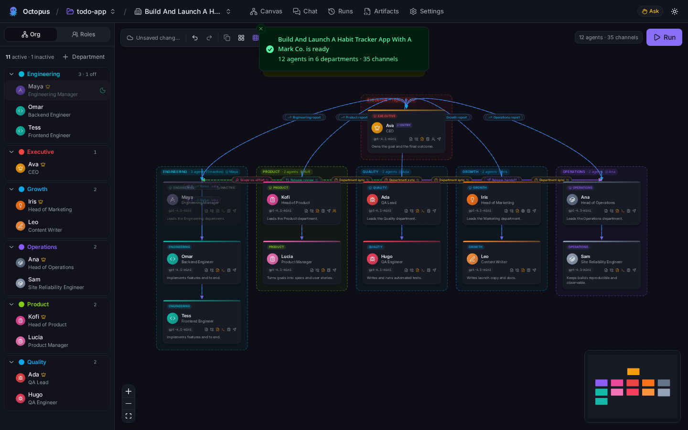
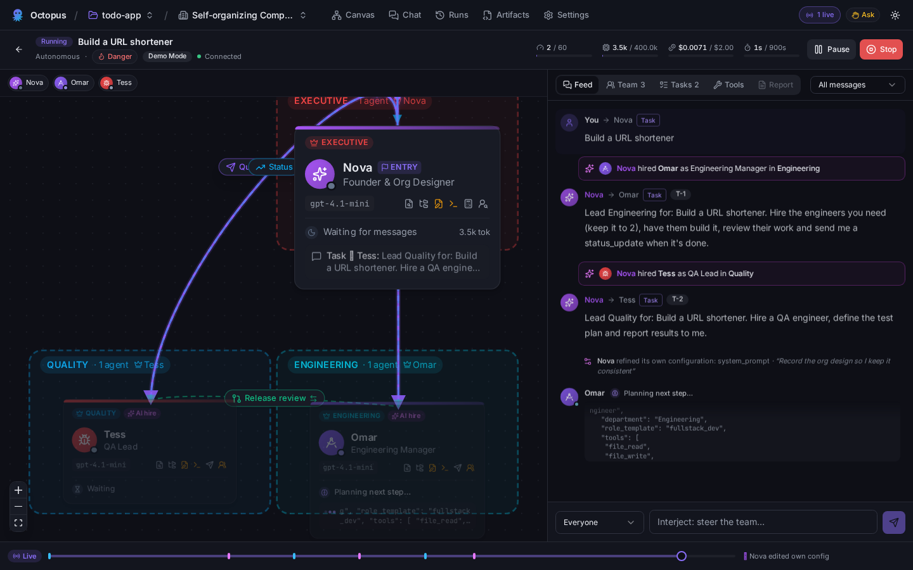

<p align="center">
  <picture>
    <source media="(prefers-color-scheme: dark)" srcset="docs/brand/banner-dark.png">
    
  </picture>
</p>

<p align="center">
  <a href="https://github.com/bala2006/octopus/actions/workflows/ci.yml"></a>
  <a href="LICENSE"></a>
  
  
</p>

**Octopus** gives you a small company of AI agents (a CEO, a product manager, engineers, a reviewer, QA…) that works inside a folder on your laptop. You pick the folder, pick a team, and give it a goal like *"Build a todo app with login"*. The agents plan, debate, delegate, write real files, review each other's code and run the tests. You watch it live, approve the risky steps, and keep the conversation going afterwards to ask for changes.

- **Local-first.** The folder you open is the agents' sandbox. Octopus keeps everything it knows about the project in `<folder>/.octopus/`, like `.git`.
- **One model, done properly.** Azure OpenAI with the `gpt-6-luna` deployment over the v1 Responses API. Token counts and costs are exact, and you choose the reasoning effort.
- **Your model, your keys.** Every agent runs on your own Azure OpenAI deployment, and keys stay encrypted on your machine.

## What you can do

**New: [Developer workbench](docs/developer-workbench.md)** brings the company agent conversation beside your code editor, with file and selection context, Agent/Plan/Ask modes, live approvals, run controls, and conversation history. Projects open in a full conversation view, with project and conversation history in the sidebar. The editor and company canvas stay one click away in the activity rail. The [workspace tools](docs/workspace.md) retain recoverable drafts, conflict-aware saves, file management, browser preview, and streamed commands, and add save-all, clean-tab refresh, detected project tasks, command-output assistance, and reviewed staged Git commits. Resize the panels and use **Ctrl+K** to find files or **Ctrl+L** to ask your team.

| | |
|---|---|
| **Open any folder** | *Open project folder* shows your system's own folder window (Finder, Explorer, zenity/kdialog), where you can also create a new folder. Octopus creates and maintains `.octopus/`: a SQLite DB, the agents' working docs (`work/`), plans, exports, browser output, a README, and `.gitignore = *`. Re-opening the folder brings everything back. |
| **Start from a template** | 14 teams: Software Startup, Web App Studio, Indie Game Studio, Mobile App Team, SaaS Launch, Data Science Team, Security Audit, Content & Marketing Studio, Customer Support Desk, Full Company, Research Lab, Small Dev Team, Debate Panel, Self-organizing. You can also let AI design a team from a prompt, or save your own. |
| **Design the org chart** | A canvas with departments, managers (♛) and typed channels: **delegate ↓**, **report ↑**, **review**, **debate**, **consult ↔**. Arrows go bottom → top between levels and side → side between peers. Undo/redo, copy/paste, auto-layout and JSON import/export are included, and changes autosave. |
| **Configure every agent** | Click a card for quick settings: name, role, prompt with `{{variables}}`, tools, MCP servers, permission level, model, and **reasoning effort** (auto · none · low · medium · high · x-high · max). Double-click for the full inspector. |
| **Run a goal** | A live graph shows who is thinking, messages moving along channels, and files as they are written. You also get a message feed, task board, tool log, approvals, pause/step/stop, interjection and a replay timeline. |
| **Continue the conversation** | Runs work like chats. After a run finishes, type *"add a dark mode toggle"* and the **same run** re-opens with its history, task board and files. The team builds on its work instead of starting over. |
| **Answer questions quickly** | When an agent needs you, it offers 2-5 answers with the best one marked **Recommended**. You can pick one (keys 1-9) or type your own. |
| **Stay in control** | Permission levels: `read_only`, `plan` (proposals only, apply later), `ask` (approve each write, command or MCP call, with a diff) and `danger`. Budgets cover turns, tokens, cost and time, and a loop detector pauses runaway runs. |
| **Let agents use a browser** | Octopus runs **Playwright MCP** on `127.0.0.1` for you. Agents with the Browser tool (on by default) get their own tab. They open the project preview, click through it and read console errors. |
| **Review the results** | *Artifacts* shows every file version with a diff, the author and the reason, plus revert, apply plan and ZIP download. *Project files* shows the whole folder, live. **Preview** renders HTML apps (with their CSS, JS and images), Markdown, images and PDFs. |
| **Know what it cost** | Exact Azure usage per call: uncached input, cached input, cache writes, and output including reasoning. Each part is priced at gpt-6-luna rates and can be shown **in your currency** (₹, €, £, …) using live exchange rates. |
| **Organise files** | Agents can `write_file`, `create_folder` and `move_file` (move or rename files and whole folders), all inside the sandbox. |
| **Chat 1:1** | Chat directly with any agent: streaming, tools, attachments (txt/md/pdf/code) and memory. |
| **Learn it fast** | A getting-started checklist and an illustrated **Guide** (`/guide`) that covers every feature. |

## Quick start

Requirements: **Python 3.11+** and **Node 24.15+** (also supported: Node 22.22.2+ and 26+). Node also powers the agents' browser.

On **Windows**, use PowerShell from this folder:

```powershell
.\octopus.ps1 setup       # create the Python venv and install locked frontend dependencies
.\octopus.ps1 start       # build when stale, then serve http://127.0.0.1:8000; Ctrl+C stops it
.\octopus.ps1 dev         # same URL, hot reload (UI patches live, backend restarts)
.\octopus.ps1 check       # inspect installed prerequisites without installing anything
.\octopus.ps1 test        # backend and frontend checks
```

If PowerShell blocks a downloaded script, run it with `powershell -ExecutionPolicy Bypass -File .\octopus.ps1 setup`. To use a particular Python installation, add `-Python C:\path\to\python.exe`. `start` rebuilds the UI only when a frontend file is newer than the build; `-SkipBuild` forces it to use the existing build. Use `-Port 8001`, or set `OCTOPUS_PORT`, when port 8000 is already occupied.

On **macOS or Linux**:

```bash
cp .env.example .env        # optional: Azure endpoint and key
make setup                  # backend venv + frontend deps
make start                  # build when stale, then serve http://127.0.0.1:8000
# or, for development with hot reload on the same URL:
make dev                    # UI + API on http://127.0.0.1:8000
```

Every mode has **one address**: `http://127.0.0.1:8000`. In development Vite serves the UI on that port and forwards `/api`, `/ws` and `/docs` to the backend on the next free port (8001 unless something else is using it), so hot reload works without a second URL to remember. In production the backend serves the built UI itself. `start.sh`, `start.bat` and the Makefile all call the same launcher, `python -m app.cli`.

1. **Open project folder** and pick or create a folder in the dialog that opens.
2. **Create company** and choose a template, for example *Software Startup*.
3. Send a message. New conversations use your installed OpenCode by default, or Azure OpenAI once it is connected in **Settings → Model**.
4. When it finishes, type a follow-up in the same box. The run continues.

### Local OpenCode

Octopus starts the OpenCode already installed on the backend computer using its [Agent Client Protocol](https://opencode.ai/v2/docs/cli/acp/). It does not download, install, or upgrade OpenCode. The integration uses its existing provider login, project configuration, tools, and permission rules. OpenCode permission requests are relayed to the conversation for approval.

The model picker lists models reported by `opencode models`. **OpenCode default** uses the model configured in OpenCode; selecting a specific model applies it to that conversation. Messages and follow-ups share a persisted OpenCode session, and responses stream into Octopus. Stop terminates the backend-owned process. Token usage feeds the personal Activity dashboard.

Run the backend on the computer with OpenCode installed: Octopus executes that local installation. If PATH discovery fails, set `OPENCODE_EXECUTABLE` in `.env` to the absolute path of the existing executable. Model settings shows connection status and the resolved executable. This host integration is available in local single-user mode. OpenCode's own tools and permission rules apply; its execution is outside Octopus's agent command sandbox. Read-only and plan conversations select OpenCode's plan agent.

## Configuration

### Azure OpenAI (gpt-6-luna)

Open **Settings → Model**:

1. **Endpoint.** Paste it exactly as the Azure or Foundry portal shows it. All of these work: `https://<resource>.services.ai.azure.com/openai/v1/responses`, `…/openai/v1/chat/completions` and `https://<resource>.openai.azure.com`. Octopus calls the **v1 API** directly (Responses by default) and needs no `api-version`. Legacy `…/openai/deployments/<name>/…` URLs still work.
2. **API key**, or Microsoft Entra ID under *Advanced* (`az login`; the identity needs the *Cognitive Services OpenAI User* role).
3. **Deployment name.** `gpt-6-luna` is prefilled.

Then **Save** and **Test connection**. Every agent runs on this deployment. If a deployment rejects a parameter (for example `temperature` on a reasoning model), Octopus drops it and remembers. Keys are Fernet-encrypted on your machine and never sent back to the browser.

**Reasoning effort.** Set it per agent (quick config or inspector), or for a whole run in the Run dialog. It is sent as `reasoning.effort` and affects quality, speed and tokens.

**Tokens and cost.** Octopus reads the usage Azure reports for every call: `input_tokens` (split into uncached, `cached_tokens` and `cache_write_tokens`) and `output_tokens` (including `reasoning_tokens`). It prices each part at gpt-6-luna Standard rates per 1M tokens: **$0.10** input, **$0.01** cached input, **$0.125** cache writes and **$0.50** output. Prompts over 272K tokens are billed at 2× input and 1.5× output, and Data Zone or regional deployments add 10%. You can override the rates under *Advanced*. Click a run's token/cost meter for the breakdown.

**Currency.** In **Settings → Appearance & currency**, choose USD (recommended, since Azure bills in USD), INR, EUR, GBP, JPY, AUD, CAD, SGD, AED, or type any ISO code. Costs are stored in USD and converted for display using European Central Bank rates via Frankfurter, with ExchangeRate-API as a fallback. Rates are cached for 6 hours, and the last known rate is used when offline.

### Built-in browser (Playwright MCP)

Octopus starts `@playwright/mcp` on `127.0.0.1` the first time an agent needs a browser, and stops it when Octopus stops. It uses Chrome if installed; otherwise it downloads Chrome for Testing on first use. Each agent gets a persistent tab and is told the project's preview URL (`/api/v1/w/<id>/preview/…`). You can check it in **Settings → MCP servers → Test browser**.

### MCP servers

**Settings → MCP servers** registers stdio servers (e.g. `npx -y @modelcontextprotocol/server-everything`) or streamable-HTTP servers. Grant them to agents from the quick config; agents call them with `mcp_call`, subject to the permission level.

### Environment variables

| Variable | Default | Purpose |
|---|---|---|
| `AZURE_API_BASE`, `AZURE_API_KEY` | – | Azure endpoint and key (the Settings page wins) |
| `DEFAULT_MODEL` | `gpt-6-luna` | Deployment for new agents |
| `OCTOPUS_PORT` | `8000` | The one public port (dev: Vite; production: uvicorn) |
| `OCTOPUS_SKIP_BUILD` | `false` | Use the existing UI build instead of rebuilding it |
| `NATIVE_DIALOGS` | `true` | Use the OS folder dialog (off: the in-app browser) |
| `BROWSER_ENABLED`, `PLAYWRIGHT_BROWSER`, `PLAYWRIGHT_HEADLESS` | `true`, auto, `true` | Agents' built-in browser |
| `WORKSPACE_ALLOWED_ROOTS` | home, `/projects` | Folders the in-app browser may show |

### Benchmark templates

```bash
backend/.venv/bin/python scripts/bench.py --projects-root ~/octopus-bench --templates solo_engineer,engineer_reviewer,software_startup
```

Runs the coding tasks in `bench/tasks.json` with each template (fresh folder per case, objective checks such as "the
tests pass") and prints pass rate, turns, coordination overhead, tokens and cost per template. `--repeat 3` evens out
model randomness.

## How it works



Agents reply with a validated JSON action schema. The server only delivers messages along channels, and every action goes through the permission gate. Octopus is a small kernel plus plugins; each one can be switched off in **Settings → Plugins**. Details (the kernel, the plugin host, the run loop, protocols, the event log and the security model) are in **[ARCHITECTURE.md](ARCHITECTURE.md)**, and the guide for writing a plugin is **[docs/plugins.md](docs/plugins.md)**.

```
octopus/
├─ backend/app/{sdk,foundation,storage,kernel,plugins,application,channels}   main.py and bootstrap.py compose them
│  ├─ migrations/{registry,project}   Alembic (applied automatically)
│  └─ tests/                          pytest: routing, protocols, limits, security, MCP, teams, scripted company runs, continuation
├─ frontend/src/{components,features/{canvas,chat,runs,artifacts,settings,workspaces,guide,onboarding},hooks,stores,lib,types}
└─ docs/{brand,media,screenshots}     logo, banners, screenshots
```

## Development

```bash
make test-backend     # pytest
make lint-arch        # import-linter: layers and plugin independence
make test-frontend    # tsc strict + vitest
make gen-api          # regenerate the typed API client after changing backend schemas
```

**CI** (`.github/workflows/ci.yml`) runs on every push and pull request:
- backend lint and tests
- frontend typecheck, unit tests and build
- a check that the generated API types are up to date

Require the **CI passed** check on `main`.

Dependabot keeps actions and dependencies up to date.

## Screenshots

| | |
|---|---|
|  |  |
|  |  |
|  |  |
|  |  |
|  |  |

## Brand

The doodle octopus lives in [`docs/brand/`](docs/brand): `logo.svg` (full), `logo-mark.svg` (a simplified mark for favicons and small sizes) and light/dark banners. The palette uses warm neutrals (`#FAF9F5` / `#1F1E1D`), a terracotta accent (`#D97756`), olive (`#6B8440`) and steel blue (`#66839A`).

## Security

- **Execution boundary.** The desktop worker runs in trusted-host mode. Filesystem tools enforce project paths, but an unrestricted host command or inherited OpenCode integration is not contained by those application checks. Restricted execution is rejected until an enforceable runner is configured. Staging folders separate cooperative edits; they are not OS sandboxes.
- **File access.** Octopus file tools reject absolute paths, `..` and symlinks that escape the folder on real paths. `.octopus/` and `.git/` are off-limits except `.octopus/work/`, where agents keep their working documents. Secret-looking filenames are blocked outside danger mode.
- **Agent commands.** They run without a shell, with a scrubbed environment, bounded output, and a timeout. POSIX also applies CPU, file-size, and process limits. Address-space limits apply to compatible runtimes; Node, Go, Java, Dart, and Flutter are exempt because their large virtual reservations prevent startup under that limit. Network is disabled with `unshare -n` where available. An allowlist applies outside danger mode.
- **Workspace commands and servers.** These start only from explicit user actions and run as local processes. They keep your user home and SDK path settings so Git identity, package configuration, and SDK discovery work, while omitting provider keys from the environment. They retain command restrictions, bounded live output, and owned-process start/stop controls. They can access the network for package installs and development servers.
- **Folder dialog.** It only opens for browsers on the same machine. The backend registers the chosen folder itself, so the browser never sends a path.
- **Preview.** Project previews run in a CSP sandbox with an opaque origin and no access to the Octopus API.
- **Browser.** The agents' browser uses an isolated, in-memory profile, so none of your cookies or logins.
- **MCP.** stdio MCP servers run commands **you** configure (`MCP_ALLOW_STDIO=false` disables them).
- **API.** It binds to `127.0.0.1`, serves the UI and API from one origin, and uses rate limiting and Pydantic validation. No cross-origin access is enabled. Single-user mode is on by default; set `SINGLE_USER_MODE=false` for JWT login.

## Agent workflows and memory

The floating chat routes unaddressed requests to one accountable lead. Use `@Name` to address an eligible specialist. A node keeps its own model and thinking level unless you explicitly choose a whole-team override.

Choose Auto, Explain, Fix, Build, or Review from the chat menu for a new conversation. Pinned pstack bundles supply the engineering steps; the backend checks ownership, ordered checkpoints, and observed evidence. Fix requires the failing reproduction to pass on the resulting revision. Tasks and Report show attempts, blockers, and stale or missing proof. A passing unrelated command cannot certify every file.

Accepted follow-ups are queued in the project database. Steering supersedes older revisions. Interrupted invocations require recovery review before retry; an approval card cannot authorize a superseded write. Independent specialists use separate text stages with base-content checks before canonical integration. The lead reviews their result before accepting completion.

Open **Memory** from agent configuration or execution details to inspect agent, group, chat, and project notes. Notes retain versions and source IDs. Sharing to a group requires an explicit audience choice. Pinned verified constraints and proposed observations are labeled separately; originals remain retrievable. These access controls apply to application retrieval and do not sandbox trusted-host processes.

Octopus uses the installed OpenCode executable without downloading or upgrading it. Auto thinking uses that CLI's default; explicit unsupported settings fail visibly. Provider quotas and authentication remain the provider's responsibility.

See the [implementation checkpoints](docs/design/agent-runtime-progress.md), [reliability evaluation](docs/design/runtime-evaluation.md), and [installed capability report](docs/design/runtime-capabilities.json). Run local diagnostics with `backend\.venv\Scripts\python.exe scripts/runtime_doctor.py` and reliability fixtures with `backend\.venv\Scripts\python.exe scripts/evaluate_runtime.py` on Windows.


## Open source and community

Octopus is released under the [MIT License](LICENSE). You may use, modify, and redistribute the project's original code subject to the license conditions. Third-party libraries, services, bundled assets, and other third-party materials retain their respective licenses and terms.

- **Contribute:** Read [CONTRIBUTING.md](CONTRIBUTING.md) and use the [pull request template](.github/PULL_REQUEST_TEMPLATE.md).
- **Report a bug or request a feature:** Use the [GitHub issue templates](https://github.com/bala2006/octopus/issues/new/choose).
- **Community standards:** Read [CODE_OF_CONDUCT.md](CODE_OF_CONDUCT.md).
- **Security disclosures:** Follow [SECURITY.md](SECURITY.md); do not share vulnerability details in public issues.
- **Support:** See [SUPPORT.md](SUPPORT.md).
