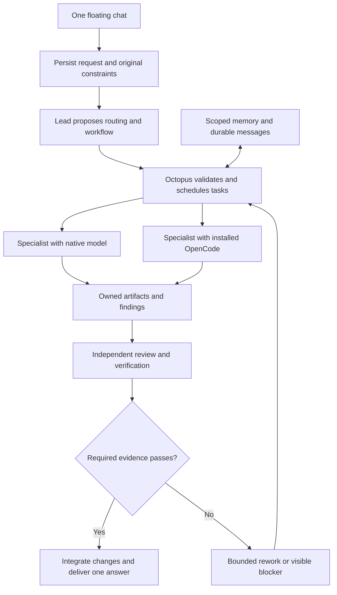
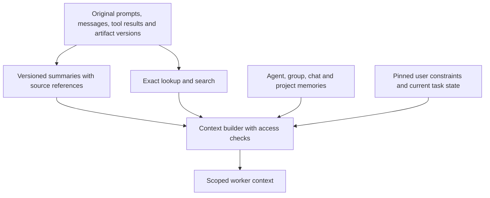

# Octopus agent runtime and pstack integration plan

Status: approved design, prepared on 2026-11-02. Implementation and measured verification are tracked in [the progress record](agent-runtime-progress.md). Comparative model quality remains a separate promotion gate.

Octopus remains a desktop product. Keep its existing frontend, backend, project databases, canvas, floating chat, and discovery of the user's installed OpenCode executable. Extend the current orchestration foundations instead of starting a second orchestration system.

## Decision and research basis

Use one accountable lead per chat, an Octopus-owned scheduler, and specialists activated according to the task. Apply pstack techniques as selected workflows with enforced completion checks. The lead proposes assignments and judgments. Backend code controls permissions, scheduling, persistence, budgets, and completion.

| Alternative | Benefit | Decision |
| --- | --- | --- |
| One OpenCode agent coordinates everything | Shortest integration path | Keep as a measured baseline. It does not by itself establish Octopus node ownership, workflow enforcement, or independent verification. |
| Octopus coordinates native and OpenCode workers | Consistent task ownership, policy, context, and evidence across providers | Recommended architecture. Requires a common worker contract and recoverable task execution. |
| Agents coordinate as an unrestricted peer network | Flexible exploration | Use bounded peer consultation inside an owned task. Avoid making consensus the source of authority. |

Google's controlled agent-scaling study found that the fit between architecture and task matters, with benefits on separable work and penalties on sequential work. That supports selecting team size by task dependencies rather than activating every node. It does not establish an Octopus performance result. [Google Research](https://research.google/blog/towards-a-science-of-scaling-agent-systems-when-and-why-agent-systems-work/)

MAST identifies system design, inter-agent alignment, and verification as distinct failure categories. The plan therefore treats coordination and completion as runtime responsibilities. [MAST paper](https://arxiv.org/abs/2503.13657)

Anthropic describes context selection, compaction, structured notes, and focused subagents as complementary techniques. Octopus should preserve original records and retrieve relevant detail rather than rely on an accumulating summary. [Context engineering](https://www.anthropic.com/research/effective-context-engineering-for-ai-agents)

OpenCode's documented ACP interface supports saved sessions, model and effort configuration, cancellation, and streamed updates. Each session accepts one active prompt. Capability-test the user's installed version before depending on documented features. [OpenCode ACP](https://opencode.ai/v2/docs/cli/acp/)

## What already exists

The owning sources were inspected for this proposal. Older quality documents describe intent and historical incidents, not proof of current behavior.

| Existing source | Reuse and current gap |
| --- | --- |
| [Skill registry](../../backend/app/services/skills.py) | Discovers skills and progressively loads their bodies. A skill-load event currently proves loading, not execution of its instructions. |
| [Workflow engine](../../backend/app/orchestrator/workflow.py) | Has phase owners, documents, gates, and bounded rework. Extend these structures with versioned contracts and stronger evidence. |
| [Permissions](../../backend/app/orchestrator/permissions.py) | Provides native agent permission caps and channel checks. Adapt equivalent restrictions for each worker backend. |
| [Runtime](../../backend/app/orchestrator/engine.py) | Contains task delegation, checkpoints, and verification events. A run-wide model currently takes precedence over node models. Delegated sub-turns cannot currently conduct arbitrary waiting consultation. |
| [OpenCode bridge](../../backend/app/orchestrator/opencode.py) | Uses one entry-agent session and returns before the native workflow path. Bring it under the common execution contract. |
| [OpenCode service](../../backend/app/services/opencode.py) | Resolves the existing executable, handles ACP, and relays approvals. Extend it with capability discovery and one reader that dispatches responses by request ID. |
| [Event bus](../../backend/app/orchestrator/bus.py) | Persists durable run events and streams live output. Extend durable queues and replay rather than rely on browser state. |
| [Scoped memory and legacy importer](../../backend/app/services/scoped_memory.py) | Imports older project notes and retrospectives from JSON once. Canonical writes use transactional scoped records; the competing JSON writer has been removed. |

## Runtime structure

Use the existing backend and SQLite storage for the initial desktop implementation. Persist requests, messages, tasks, and transitions transactionally. Keep database transactions short and publish committed events through an outbox. The frontend subscribes to updates; it does not own the execution queue. Existing SQLite WAL supports concurrent readers, but writing still needs explicit coordination. [SQLite WAL](https://www.sqlite.org/wal.html)

### Ownership, rules, and models

Separate the reporting tree, task dependencies, and communication channels. A reporting edge defines who resolves a decision. A task dependency defines what must finish first. A consultation channel defines who can exchange information. None of these relationships grants tool permissions.

Give every task one owner and every change set one integration owner. Use a shallow lead-to-specialist hierarchy initially. Add department managers only when measured task scale justifies them. Required independent reviews cannot be performed by the builder of the same change.

Select and persist the lead when a chat starts. Prefer the chat's existing lead, then its unique active entry agent. For an older canvas with several entry agents, preserve the previous run's primary entry agent when available. Otherwise select a stable active entry agent and record that automatic choice visibly. The user can change the lead before execution. Other entry agents remain available specialists rather than becoming competing chat leads.

| Contract | Required information |
| --- | --- |
| Agent profile | Stable ID, role, responsibilities, capabilities, node model and thinking preference, reporting relationship, permitted memory groups |
| Request | Original prompt, chat and project IDs, attachments, explicit target, pinned constraints, revision |
| Task | Owner, acceptance criteria, dependencies, allowed write targets, workflow version, budget, current state |
| Attempt | Task revision, worker session, effective policy, skill versions, workspace base revision, cancellation epoch |
| Skill bundle | ID, version, origin, content hash, references and scripts, required capabilities, expected inputs and outputs |
| Evidence | Requirement IDs, exact artifact manifest, environment, check executed, result, producer, time |
| Memory record | Scope, readers, author, source references, version, verification state, replacement or expiry information |

Use typed contracts and explicit task states. A suitable initial lifecycle is queued, investigating, ready, running, waiting for a reply, awaiting approval, verifying, completed, unverified, blocked, failed, superseded, or cancelled. Define allowed transitions in one place. Explain-only work completes through its evidence requirements and does not need a build phase.

Backend permissions take precedence over role descriptions, skills, imported project instructions, and model requests. Calculate allowed capabilities from the intersection of user grants, project policy, task scope, and the agent profile. Instructions cannot increase that set.

Resolve models in this order: an explicit whole-team override selected by the user, an explicit node choice, an approved role default, then the project default. Label the whole-team override clearly. A normal chat model selection controls the lead or the new-agent default according to its visible scope. It must not silently replace explicit node choices.

For thinking effort, respect explicit user settings. Auto may choose an effort within the task's budget and provider capabilities. Snapshot effective model, effort, policy, and skill versions for each attempt. Discover real model IDs from the installed provider configuration. Report unavailable models instead of silently substituting a demo or another model.

### Routing and pstack workflows

Persist the request before routing. An explicit mention selects an eligible target. Otherwise, follow the current task owner for an associated follow-up. Use the lead to classify new requests and select the smallest suitable workflow. Ask a narrow clarification only when uncertainty materially changes the work.

Every assignment contains the goal, acceptance criteria, relevant evidence, dependencies, permitted tools and files, budget, and return format. Agents receive enough shared source material to avoid repeated paraphrasing of the user's intent.

| Workflow | Execution pattern | Pstack techniques |
| --- | --- | --- |
| Explain | Inspect sources, check claims, answer | how, why when motivation matters |
| Fix | Reproduce, isolate cause, change, review, repeat the reproduction | bug-fix playbook, fix-root-causes, appropriate regression tests |
| Build | Define acceptance criteria, design, implement, integrate, verify | feature playbook, architect when design risk warrants it |
| Review | Inspect the artifact and surrounding behavior, return evidenced findings | interrogate for significant risk, blast-radius checks when relevant |
| Design comparison | Produce isolated alternatives, compare against a rubric, select and combine | arena |
| Independent exploration | Assign disjoint questions or deliverables, consolidate source-backed results | swarm |
| Improvement proposal | Compare a proposed workflow or skill version against a baseline | eval, reflect, encode-lessons-in-structure |

Initial defaults are Explain, Fix, Build, and Review. Design competitions and extra reviewers are bounded options. A visible node does not have to run, and a skill does not need a permanent agent node.

Import reviewed pstack bundles with their referenced files and scripts. Translate host-specific subagent names and tool calls into Octopus capabilities. Loading Markdown is guidance. Backend validators control step transitions, mandatory artifacts, budgets, and evidence requirements. Do not translate arbitrary Markdown directly into privileged shell commands.

Pin the selected bundle and workflow versions for an attempt. A changed skill file affects new work only. Display origin and overrides so a project skill cannot silently impersonate a trusted verifier. Keep automatic PR creation, deployment, customer communication, and broad autonomy outside default workflows.

### Worker execution and containment

Native and OpenCode workers receive the same assignment contract and emit compatible lifecycle, message, artifact, approval, and evidence events. Keep Octopus as the only scheduler. Disable autonomous worker-side subagent spawning by default until every child can be owned, scoped, cancelled, and accounted for through that scheduler.

Use only the existing installed OpenCode executable and credentials. Probe initialize and session responses, available models and effort options, cancellation, recovery, and policy behavior. Unsupported capabilities produce an explicit blocked or reduced-capability state. No installation or upgrade is part of this plan.

Create private runtime configuration for each worker through a supported configuration mechanism. Preserve the user's global configuration and authentication store. Record effective settings after applying the worker configuration, including inherited instructions and integrations. If the installed version cannot control an inherited capability required by the task's isolation policy, reject that worker configuration.

Start with a separate process for each isolated worker profile and one active prompt per session. Consider process pooling only after proving that configuration and integrations remain isolated. Implement one process reader that dispatches RPC responses and session events, rather than letting concurrent callers compete for stdout.

OpenCode uses directory configuration, including instructions, plugins, and MCP servers. Its client-provided MCP configuration can be visible to other sessions in the same directory. Keep private integrations isolated and verify effective inherited configuration. [ACP session and integration semantics](https://opencode.ai/v2/docs/cli/acp/)

Worktrees isolate edits, not operating-system access. OpenCode's host shell uses the user's filesystem, process, and network authority. A private-memory retrieval API does not protect a database from an unrestricted shell. [OpenCode permissions](https://opencode.ai/v2/docs/permissions/)

Define two explicit execution modes. Trusted-host mode provides cooperative context scoping and policy checks, with no claim of hostile-worker isolation. Restricted mode requires tested filesystem, process, network, and tool restrictions. Use brokered capabilities and an operating-system boundary where needed. Verify deny behavior with harmless probes. If required restrictions cannot be enforced, block that worker from the affected task. Never advertise stronger memory privacy than the execution boundary supports.

For the first desktop release, retain trusted-host execution as the explicit default and describe agent memory scopes as controlled context sharing. Enable restricted mode only when its capability checks pass on the installed Windows environment. Tasks requiring strong isolation are ineligible for trusted-host workers. Start with at most three simultaneous model invocations, including the lead, and two delegated levels. All workers share the request's existing cost, time, and turn budget. These are initial limits to evaluate, not measured optimal values.

### Messaging, queueing, and steering

Use task-scoped pair and group channels with recipient checks. Each message has a stable ID, task revision, sender, recipients, type, reply reference, and artifact links. Persist messages before acknowledging receipt. Deliver at least once and deduplicate consumers. Stream durable updates and ephemeral text through the existing frontend connection.

Support question, answer, assignment, finding, review result, decision, blocker, and status messages. Share useful results and references rather than every token or hidden reasoning.

A consultation creates a reply ticket and a waiting task state. The worker yields its invocation and releases its execution slot. A reply resumes the task with relevant context. Add deadlines and wait-cycle detection. Do not block a parent invocation while its child needs a response from that same parent.

User controls have separate meanings:

| Control | Runtime meaning |
| --- | --- |
| Queue | Persist a new request to run after applicable dependencies finish. Preserve attachments and order across browser or backend restarts. |
| Steer | Create a revised assignment. Mark affected prior attempts and dependent proof superseded. Cancel or finish the old invocation before reusing its session. |
| Pause | Stop scheduling new actions and reconcile the current invocation at a supported safe point. If the backend cannot truly suspend it, report the interruption and resume from a checkpoint. |
| Stop | Cancel the selected work and prevent new actions. Record any side effects that already occurred. Cancellation is not rollback. |

Late output from an older revision remains historical. The coordinator refuses to use that output to satisfy current criteria or mutate the current task record. It integrates only artifacts from eligible current attempts. Preventing direct writes to the canonical workspace additionally requires brokered filesystem access or an enforced execution boundary. A trusted-host worker can bypass a worktree by using an absolute path, so reconcile outstanding processes and canonical file changes before treating cancellation as contained. Detect and reconcile unknown external effects before retrying them.

### Memory and context

Store complete application-visible messages, results, and versioned artifacts according to the user's retention settings. Summaries are derived records and do not replace originals. Hidden model reasoning is not required for this archive.

Full detail means authorized, policy-permitted detail. Filter known credentials and restricted payloads before ordinary logging, storage, or summary generation, and record that redaction occurred. Keep sensitive raw evidence only when explicitly needed and permitted, with separate access controls and retention. Do not place private external data into broad project retrieval. Secret filtering reduces accidental capture; it is not a guarantee that arbitrary generated text contains no sensitive data.

| Scope | Readers and purpose |
| --- | --- |
| Agent | The owner agent through authorized tools. Working notes and unresolved details. The user retains control. |
| Group | Explicit members, including arbitrary pairs or larger groups. Shared contracts and investigation findings. |
| Chat | Agents assigned to that chat according to policy. User intent, decisions, task progress, and unresolved questions. |
| Project | Authorized project agents. Verified conventions, architecture decisions, and reusable facts. |

Move canonical memory writes into transactional storage. Preserve existing notes through an idempotent migration. Start with exact references, structured filters, and full-text search. Add semantic retrieval only if recall evaluations show a need.

Build each prompt from pinned original constraints, the current assignment, relevant recent turns, a bounded summary, and permitted retrieved details. Record source IDs and the summary's coverage boundary. Mark observations, hypotheses, verified facts, and superseded facts separately. Resolve conflicts against authoritative sources and explicit user corrections. Prefer regenerating summaries from originals over repeatedly summarizing summaries.

Apply access checks before retrieval and again when using cached retrieval results. Revoking access prevents future retrieval, but cannot undo disclosure to an existing context. Reset affected worker sessions when stronger separation is required. Long-term rule promotion requires review and evaluation. A worker cannot silently rewrite shared instructions from one experience.

The lead may propose or publish an evidence-backed project fact only when the task policy permits publication and its source scope permits that audience. Unverified conclusions remain observations or proposals. The user or project owner approves changes to shared rules, skills, permissions, and lasting behavioral defaults after evaluation. Private or group information is not promoted to a wider scope without the required sharing grant.

### Verification and integration

Every required acceptance criterion maps to a check, an artifact review, or an explicit human judgment. Record the exact artifact content manifest, task revision, environment, commands or interaction scenario, outputs, result, and verifier identity.

A successful unrelated command does not verify the project. A screenshot does not alone prove a lifecycle interaction. Evidence becomes stale when relevant artifacts, dependencies, requirements, or environments change. Verify the integrated result after merging worker changes. When targeted invalidation is uncertain, rerun the broader relevant checks.

Workers propose patches or versioned artifacts. Git projects use separate worktrees where practical. Other projects use isolated staging directories with base-version checks. A single integration owner resolves conflicts in the canonical workspace. Code review and executed checks provide different evidence; model agreement alone cannot substitute for a test result.

Expose completed, unverified, blocked, failed, superseded, and cancelled outcomes accurately. An unavailable mandatory verifier cannot become a silently skipped passing phase.

## Delivery sequence and acceptance gates

The sequence follows pstack's Model the Domain, Prove It Works, Separate Before Serializing Shared State, and Sequence Work into Verifiable Units principles. Each phase ends in an observable check before the next capability becomes a default.

| Phase | Deliverable | Required acceptance gate |
| --- | --- | --- |
| 0. Baseline and scope | Representative fixtures, current native and OpenCode measurements, installed-capability report, execution trust model | Reproduce existing behavior. Record costs and unknowns honestly. Preserve the installed CLI and existing project data. |
| 1. Task and policy contracts | Versioned request, task, attempt, profile, workflow, rule, and evidence records | Reject cycles, invalid transitions, unauthorized capability changes, and unavailable model settings. Explicit node choices survive normal routing. |
| 2. Worker contract | Native and OpenCode adapters, capability discovery, policy probes, request/event dispatch, session ownership | Both adapters execute the same scoped single-worker task and report the same lifecycle. Unsupported restrictions fail visibly. One session never runs two prompts concurrently. |
| 3. Durable control | Database-backed queues, transactional outbox, checkpoints, deduplication, approval recovery, steer and stop revisions | Restart at each boundary preserves work without blind repetition. Old attempts cannot alter current task state. Browser closure does not lose queued prompts. |
| 4. First pstack workflow and proof | A pinned Fix workflow with reproduction, implementation, and artifact-bound verification | The original failure is reproduced, the fix is applied, the same reproduction passes, and changing the certified artifact makes its evidence stale. Run this slice through both adapters. |
| 5. Context and memory | Private, group, chat, and project records, migration, source-preserving summaries, scoped retrieval | No lost concurrent notes. Unauthorized retrieval is denied. Critical instructions survive compaction. Original details remain retrievable. Privacy claims match the worker boundary. |
| 6. Controlled teams | Explain, Fix, Build, and Review templates, independent review, dependency scheduler, waiting consultation, isolated writes | A producer finishes before dependent review starts. Peer questions resume correctly. Conflicting writes require integration. Missing mandatory review blocks verification. |
| 7. Desktop controls and evaluation | Compact node configuration, typed canvas edges, task/evidence views, measured routing defaults, optional arena and swarm | Users can see owner, workflow step, queue, blockers, evidence, and memory sources. Teams become defaults only for task classes that meet predefined quality and resource targets. |

Read-only inspection, fixture design, and UI mockups can proceed in parallel after the contracts are agreed. Worker lifecycle, policy, task state, and database mutations need one integration owner because they share execution semantics.

The first complete slice is one request, one specialist, one pinned Fix workflow, and revision-bound evidence. The second slice adds an independent reviewer. Parallel specialists and design competitions come later. Importing every pstack file is not an initial milestone.

## Desktop experience

Keep the floating chat as the input surface and the canvas as the team view. A collapsed chat shows status, while queued and streaming work continues in the backend.

The default node editor shows name, role, model and thinking, and active or lead status. Team relationships, tools, memory groups, and assigned skill bundles remain available in expanded settings. Display effective capabilities rather than implying that a role title grants them.

Provide Auto, Explain, Fix, Build, and Review as task workflow choices. In Auto, show the selected target and workflow before or as work starts. The Tasks view shows ownership and dependencies. Tools shows actual execution. Report shows acceptance evidence, remaining limitations, and verified revision. Group messages and routine progress belong in expandable activity; decisions, questions, and blockers remain visible in the main conversation.

Expose quality and resource limits in advanced controls. Keep pstack model-role mappings as policy, not a requirement for users to manage several configuration files. Native providers and OpenCode must display their effective selected models consistently.

## Required acceptance scenarios

1. An explicit agent mention routes to that eligible agent. A mixed frontend/backend request creates owned subtasks without broadcasting the full job to every node.
2. A node configured with a distinct model and effort actually uses those settings. An explicit whole-team override is visible and recorded.
3. A UI bug reproduction covers opening the model popup, collapsing chat, restoring chat, and checking the popup's anchor. A build-only result cannot pass that requirement.
4. Steering during streaming creates a new revision. Late tokens and artifacts from the older attempt cannot certify the new work.
5. Stopping during an active tool call prevents new actions and reports remaining side effects accurately.
6. A crash after a committed message but before delivery replays the message without repeating an already reconciled mutation. Unknown prompt acceptance requires recovery rather than an automatic duplicate prompt.
7. Agent A asks agent B a question, yields, and resumes with B's answer. A circular waiting dependency becomes a visible blocker.
8. Concurrent workers change the same base file in separate workspaces. Integration detects the conflict and verifies the merged revision.
9. A restricted worker cannot use another tool or inherited integration to bypass its scope. A trusted-host worker does not receive a misleading strong-isolation label.
10. Unauthorized agent and group memory requests are denied. A deliberately faulty summary cannot replace a pinned user constraint or verified source record.
11. A passing check for revision 3 becomes stale after a relevant revision 4 edit. Unrelated successful commands do not clear that status.
12. A skill requesting wider permissions is rejected. Editing an imported skill during a task does not change the task's pinned bundle. A malicious project override cannot replace a trusted completion validator.

## Quality evaluation and rollout

Compare the existing single OpenCode path, the existing native path, and the proposed workflow on the same representative requests. Then compare solo execution, a builder with an independent reviewer, and small specialist teams. Use comparable available models and total budgets so extra spending is visible.

Begin with a small fixture set containing real Octopus tasks, then use held-out acceptance cases and repeated runs. Include small questions, single-file fixes, multi-file features, independent research, conflicting edits, context compaction, consultation, approval, steering, and restart recovery. For free-form results, use a defined rubric and human spot checks alongside automated checks. Blind model and workflow labels in artifact reviews where practical.

Measure requirement satisfaction, correctly verified completion, escaped defects, time to usable result, total tokens and cost, user interventions, and recovery behavior. Record unavailable costs as unknown. Measure orchestration overhead separately from worker effort. A result can be correct while the workflow is too slow or expensive for that task class.

Define release thresholds before comparing candidates. Every mandatory reliability fixture must pass. Enable a team strategy by default only for task classes where evaluation justifies it within the chosen budget. Preserve a short solo path for simple or tightly dependent work. Roll out one workflow at a time with a way to return to the prior version.

Initial promotion criteria are all twelve reliability scenarios passing, no observed regression on the held-out solo cases, and a repeatable improvement in verified requirement satisfaction at a comparable total budget. A latency-focused strategy may instead qualify by preserving quality and reducing time to usable output within its declared cost cap. Record uncertainty and expand the sample when results are close. A single favorable run is insufficient.

Treat skill and rule improvements as proposed versions. Test them against prior successes and prior failures before promotion. Preserve an append-only decision trail with source and evidence references. Do not automatically promote one agent's retrospective into organization-wide policy.

## Scope limits

This plan does not assume new OpenCode downloads, Docker, cloud queues, a vector database, a new distributed workflow platform, automatic deployment, or unlimited agent fan-out. Add infrastructure only when measured limits require it.

The recommended architecture is the best fit identified for Octopus's present desktop constraints. A universal quality advantage is not claimed. The evaluation phase decides which combinations of agents, models, thinking settings, and pstack workflows earn a default place in the product.
